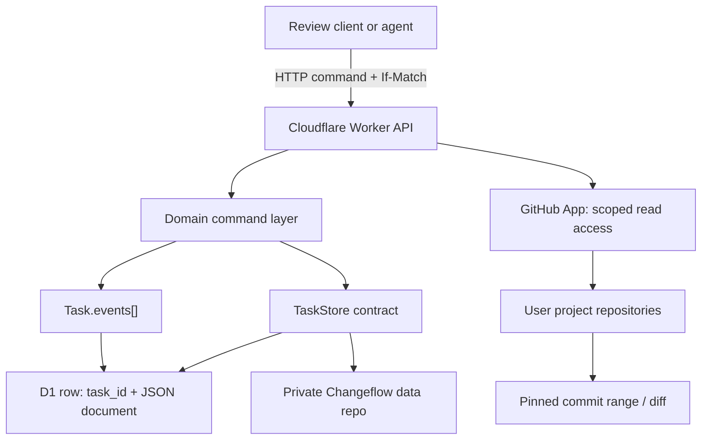

# Changeflow System Specification — Cloudflare JSON-Blob Prototype

**Status:** implementation prototype, not production-ready
**Version:** 0.1
**Runtime target:** Cloudflare Workers + D1 (SQLite)
**Primary design constraint:** one self-contained JSON document per Task, changed with optimistic concurrency control.

## 1. Purpose

Changeflow keeps engineering review state independent from Git history. A Task is the unit of collaborative work. A Changeset is a stable, reviewable unit inside that Task. Its implementation can be rewritten, split, merged, or normalized before merge while the event log preserves what happened and why.

This prototype includes a Cloudflare Worker API, the mobile-first Changeflow browser client, GitHub App sign-in, and a GitHub Contents API adapter for a dedicated private data repository. GitHub sign-in establishes an identity with D1-backed, short-lived sessions; it does not yet authorize Task API access per user. There is no code-repository/PR integration or agent runtime. Production multi-user authorization and MCP agent consent remain future work in [`AUTH_AND_AGENT_ACCESS.md`](./AUTH_AND_AGENT_ACCESS.md).

## 2. Design decisions

1. **One Task is one JSON document.** D1 stores `task_id` as the key and the complete Task JSON in `document_json`. The optional GitHub adapter stores the same document at `tasks/<taskId>.json`. Relational modeling is intentionally avoided for Task state. A future multi-user service can still use small D1 tables for accounts, GitHub installations, OAuth sessions, and revocable agent grants; these are authorization metadata, not a normalization of the Task document.
2. **Optimistic concurrency is at Task scope.** Every accepted mutation increments `revision`. A caller must supply the revision it read. D1 performs compare-and-swap in one conditional `UPDATE`.
3. **The first event log lives in the same document.** Every comment and state transition is appended to `events[]`, with one or more `{kind,id}` targets. This makes the state and its audit trail atomic. The same event envelope can later be copied into an append-only table or external event store.
4. **The storage port is replaceable.** Domain commands depend on `get`, `create`, and `compareAndSwap`; they do not depend on SQL, GitHub, or Azure. D1, in-memory, and GitHub Contents adapters implement the same contract. An Azure Blob adapter can use a blob per Task plus `If-Match` with the blob ETag.
5. **Stable patch identity is separate from Git SHA.** Approval is tied to a patch fingerprint plus relevant dependency and knowledge state. A commit SHA rewrite by itself does not revoke approval.
6. **The agent owns structural implementation actions.** Humans create general requests; the agent applies split, merge, and implementation changes. The event log keeps the request and the structural result connected.
7. **One commit per Changeset is a finalization target, not a development constraint.** While iterating, a Changeset can refer to a bundle of commits. Before merge, an agent can rewrite history into one commit and preserve approval when the logical patch is unchanged.
8. **Task storage and source-code repositories are separate connections.** A user's private Changeflow data repository stores Task JSON. One or more separately authorized project repositories hold source code and provide immutable Git objects for review. A Changeset explicitly points to a code repository and commit range; the system never infers semantic dependency from commit order.

## 3. Components



### 3.1 Worker API

`src/index.js` owns routing, GitHub authentication dispatch, prototype API bearer-token checks, request size limits, ETags, idempotency, and response mapping. It does not own domain rules. Static assets are served by the same Worker origin.

### 3.2 Domain

`src/domain.js` applies validated commands to a cloned Task document and returns a new document. A command is all-or-nothing from the caller's perspective. It is safe to test without Cloudflare bindings.

### 3.3 Storage adapter

`src/store.js` documents the storage port and contains D1 and in-memory adapters. `src/github-store.js` implements the same port against a private GitHub data repository. The storage contract is intentionally small and has no provider-specific token in its method signatures:

| Method | Contract |
|---|---|
| `get(taskId)` | Return the current JSON document or `null`. |
| `create(document)` | Insert only if the stable Task ID is unused. |
| `compareAndSwap(taskId, expectedRevision, nextDocument)` | Atomically replace only if current revision equals expected and new revision is exactly expected + 1. |

The domain layer only calls those three methods. A D1 row revision, GitHub file blob SHA, or future Azure Blob ETag is an implementation detail inside the adapter.

## 4. Persistence model

### 4.1 D1 schema

The initial migration creates one table:

```sql
CREATE TABLE task_blobs (
  task_id TEXT PRIMARY KEY,
  document_json TEXT NOT NULL CHECK (json_valid(document_json))
) STRICT;
```

There is no separate row for a Changeset, event, decision, or assumption. `json_extract(document_json, '$.revision')` is used only to enforce the compare-and-swap condition.

### 4.2 Optional GitHub repository storage

`GitHubContentsTaskStore` stores one JSON file at `tasks/<taskId>.json` in a dedicated private repository. It uses GitHub's Contents API: reads the current file and its blob SHA, then sends that SHA with the new file content. The SHA is a provider-private CAS token; it is not copied into the Task document and does not affect Changeset approval.

The adapter caps a Task document at 900,000 UTF-8 bytes. This stays within the Contents API representation where base64 file content is returned. GitHub documents that the endpoint supports all features for files up to 1 MB and requires the existing blob SHA for updates. Each accepted mutation creates a Git commit in the data repository. That gives a convenient external history/backup, but also means normal review actions write Git commits.

GitHub's documentation warns that parallel Contents API operations can conflict and recommends serial requests to avoid secondary rate limits. The file SHA protects concurrent writes to the same Task from being silently overwritten; it does not make a shared branch a database transaction across multiple Task files. If multiple Tasks are frequently written in parallel, use D1/Azure for mutable state or move to a Git Data API strategy with explicit branch-head compare-and-swap. See [Contents API](https://docs.github.com/en/rest/repos/contents) and [REST API best practices](https://docs.github.com/en/rest/using-the-rest-api/best-practices-for-using-the-rest-api).

For the single-developer, low-volume prototype, GitHub storage is a reasonable way to keep state in a repository you can inspect and back up. Keep that repository private: Task files contain review discussions and engineering context. Use a fine-grained token or GitHub App installation token scoped to Contents write on only that repository. The token belongs in a Worker secret, never in client code or the Task document.

### 4.2.1 Data repository versus project repositories

There are two distinct repository roles. They may belong to the same GitHub account, but are separate authorization connections and must be labeled separately in the product:

| Repository role | Holds | Changeflow access | Mutations by Changeflow |
|---|---|---|---|
| **Changeflow data repository** | `tasks/<taskId>.json`: review state, events, decisions, assumptions, requests, and feedback. | Contents read/write, limited to the selected private repository. | Writes Task JSON revisions. It never contains the user's application source by default. |
| **Project/code repository** | The source code and Git objects being reviewed. | Metadata and Contents read-only initially; add Pull requests read only if an integration needs it. | None. Changeflow does not push commits, create branches, or merge PRs in the review MVP. |

The user explicitly connects each role. GitHub login alone is not consent to either repository. A selected code repository can be connected to many Tasks; a Task can reference multiple code repositories for a multi-repo change. Repository references use GitHub's stable numeric repository ID plus the owning installation/connection ID, not a caller-provided `owner/name` as an authorization key. Store installation IDs, repository selections, and permissions in the account/authorization layer described in [`AUTH_AND_AGENT_ACCESS.md`](./AUTH_AND_AGENT_ACCESS.md), not in Task JSON as credentials. A Task may store a stable `codeRepositoryId` reference, but authorization is resolved server-side for the authenticated owner before any GitHub read.

### 4.2.2 Linking Changesets to code and obtaining a review diff

Each implementation revision carries one or more `codeRefs`. A code reference identifies the repository and an explicit snapshot range, independent of the Changeset's stable ID:

```json
{
  "repositoryId": "github-repository-numeric-id",
  "baseCommitSha": "0123456789abcdef...",
  "headCommitSha": "abcdef0123456789...",
  "commitShas": ["commit-a", "commit-b"],
  "paths": ["src/Requests.cs", "test/RequestsTests.cs"]
}
```

`baseCommitSha` and `headCommitSha` pin the exact before/after snapshots for the review. `commitShas` identifies the implementation commit bundle that the agent associates with this Changeset; the bundle must represent one reviewable range in the first integration. `paths` is optional explanatory/indexing metadata, not an authorization boundary or a way to silently filter out changes. If work truly spans disconnected commit ranges or repositories, represent multiple explicit code references and render their diffs as separately labeled sections. Do not infer the mapping from commit subjects, Git order, branch names, or PR position.

The flow is:

1. The user connects a project repository through the GitHub App, granting read-only access. Changeflow stores its repository ID and installation connection in account metadata.
2. The agent creates/updates a Changeset with the repository ID, base/head SHAs, commit bundle, and optional path hints. The API verifies the repository belongs to the user's active installation and that the referenced commits exist.
3. The review client asks Changeflow for the diff of that Changeset implementation revision. The Worker resolves the authorized installation token and fetches the pinned comparison from GitHub; the browser never receives GitHub credentials.
4. The response is a normalized file list with status, rename metadata, additions/deletions, and patch hunks. The UI renders file headers and hunks with side-by-side or unified mode on wide screens and unified horizontally scrollable code on phones. Binary, generated, oversized, or unavailable patches are labeled; they are not silently omitted.
5. The Worker computes and records a logical patch fingerprint from canonical file paths, change types/modes, and patch/content changes, excluding commit metadata and SHAs. Approval basis references that fingerprint, plus dependency and knowledge fingerprints. A rewritten SHA with the same patch retains approval; changed patch or relevant basis invalidates it.

For a contiguous commit bundle, first use GitHub's compare-commits endpoint with the pinned base/head and request the diff/patch media type or structured file response. GitHub can return file patches directly, but responses have limits and a tree listing can be marked truncated. If the compare response is incomplete, the Worker must use a deterministic fallback based on the two pinned commit trees and blobs, or mark the diff unavailable and block approval; it must never show a partial diff as complete. GitHub's Git Trees and Blobs APIs provide the underlying objects for that fallback. See [compare commits](https://docs.github.com/en/rest/commits/commits#compare-two-commits), [Git Trees](https://docs.github.com/en/rest/git/trees), and [Git Blobs](https://docs.github.com/en/rest/git/blobs).

Diffs should be fetched on demand and cached only as derived, short-lived data keyed by `{repositoryId, baseCommitSha, headCommitSha}`. Do not duplicate full source patches inside the Task JSON: they can be large, can become stale if stored against the wrong revision, and the Git repository remains the source of truth. A later audit may store the bounded normalized fingerprint and diff metadata in the Task event, while code contents stay in GitHub. Respect GitHub API rate limits, enforce response and file-size caps, reject unknown repository IDs before making upstream calls, and never fetch arbitrary user-supplied URLs (to avoid SSRF).

### 4.3 Task document shape

The schema is versioned and stored as JSON. The current shape is represented in `src/domain.js` and follows this outline:

```json
{
  "schemaVersion": 1,
  "taskId": "backend-refactor-42",
  "revision": 7,
  "iteration": 2,
  "title": "Refactor request handling",
  "description": "...",
  "status": "review",
  "changesets": [],
  "decisions": [],
  "assumptions": [],
  "requests": [],
  "feedbackPackages": [],
  "events": [],
  "createdAt": "...",
  "updatedAt": "..."
}
```

Identifiers are stable strings. The expected collections are:

- **Changeset:** stable `id`, title, intent, dependency IDs, active/archive lineage, implementation revision, logical `patchFingerprint`, commit bundle, explicit `codeRefs` to authorized project repositories and pinned base/head commits, decision/assumption links, review status and approval basis, implementation history.
- **Decision:** stable `id`, statement/title, active/rejected/cancelled status, revision, and linked Changeset IDs. Cancellation is retained as a state and event; records are not deleted.
- **Assumption:** stable `id`, statement/title, unverified/verified/rejected status, revision, linked Changeset IDs, rejection reason, and `needsInvestigation`. A rejected assumption without a reason sets `needsInvestigation: true`; assumptions cannot be cancelled.
- **Request:** stable `id`, category, optional target references, status and ordered human/agent messages. Requests are general instructions; split/merge are examples of requests, not the request type system.
- **Event:** stable event ID, command ID/hash, document revision, ordinal, type, actor, targets, structured payload, summary, timestamp. Events are append-only through domain commands.

### 4.4 Task-wide event log

`events[]` is a single chronological log. Each event can target the Task or multiple records. A comment on a Changeset, a decision correction affecting several Changesets, and a split with a result list all use this same envelope. API clients can filter by revision and render event targets as links.

The event payloads preserve prior discussion and states. The current document is a materialized state plus the event history, not a replacement for history. An event may contain a summarized resulting state to make audit display practical; clients should not infer missing state transitions from prose summaries.

**Growth strategy:** D1 row size is bounded by Cloudflare's row maximum; this prototype applies a lower 1.5 MB JSON-document cap. Before approaching that cap, introduce a storage-format migration that archives older events as immutable chunks (or moves events to an append-only store) while retaining the current state blob and stable event cursors. Do not silently trim history.

### 4.5 Synchronous writes versus append-first processing

The current API is synchronous: it accepts a command, applies it to the Task snapshot, and returns the new revision (or a conflict). This fits the expected usage of one human reviewer and one implementing agent working on a Task. Optimistic compare-and-swap is enough to prevent lost updates, and the caller can reload and retry when both happen to write at once.

An append-first design would be a different command-processing architecture, not just another implementation of `TaskStore`:

1. The API durably accepts an immutable command/event with an idempotency key and returns `202 Accepted` plus an operation ID.
2. A worker sequences and applies commands to the Task snapshot, recording success or failure.
3. The client polls an operation endpoint until it reaches a terminal status.

The worker then needs durable ordering per Task, claiming/leases, retries, poison-command handling, idempotent projection, operation retention, and a recovery path. Debouncing can reduce snapshot writes, but it must not debounce or discard accepted events. The TaskStore port should remain about reading/writing materialized Task state; if this model is later needed, introduce a separate `CommandInbox`/`OperationStore` abstraction.

For a GitHub-backed prototype, appending one file per accepted command still creates a GitHub Contents API write/commit for every command. A debounced snapshot worker adds another commit for the materialized state, so it does not reduce the append-side write count. A single `pending.json` file would need read-modify-write and recreate the same concurrency problem. Each file update also commits against the repository branch. GitHub recommends serializing mutative API requests; therefore, even when same-Task concurrency is low, writes to different Task files should not be assumed to be independent database transactions. The current one-Task-file CAS adapter is simpler for the stated one-human/one-agent usage; storage-provider conflicts return a retryable `503`, and D1 remains available if repository writes become noisy.

For Azure, there are two distinct designs:

| Azure shape | Atomicity and behavior | When it fits |
|---|---|---|
| **One Blob per Task, synchronous ETag CAS** | Read the blob and replace it with `If-Match`. A stale ETag fails. Simple, and it preserves the current synchronous API and JSON-blob model. | Best first Azure adapter when writes are low-volume. |
| **Table state row plus event rows in one Task partition** | Azure Table entity-group transactions can atomically update the state row and append event rows when they are in the same table and partition. Table ETags provide optimistic concurrency. | Useful if event history needs separate rows while atomic state+event writes remain important. This no longer stores the whole Task in one Blob. |
| **Table command inbox plus Blob snapshot projection** | The Table is the durable accepted-command log; a worker applies commands and writes the Blob snapshot asynchronously. The API returns an operation ID and the client polls. Blob and Table do not share a transaction, so the worker must be replay-safe and record a processed sequence/cursor. | Useful only when decoupled ingestion or durable queuing becomes a real requirement. |

Table entity-group transactions are limited to one table and one `PartitionKey`; Microsoft documents a maximum of 100 entity operations and a 4 MiB transaction payload. Blob writes use ETag `If-Match` for optimistic concurrency. See [Azure Table entity-group transactions](https://learn.microsoft.com/rest/api/storageservices/performing-entity-group-transactions), [Azure Table ETag updates](https://learn.microsoft.com/en-us/rest/api/storageservices/update-entity2), and [Blob concurrency](https://learn.microsoft.com/en-us/azure/storage/blobs/concurrency-manage).

**Recommendation for this prototype:** keep the synchronous three-method `TaskStore` contract. The append-first design is viable later, especially with Azure Table as a same-partition event/state store or a deliberate Table-to-Blob projection, but it adds distributed workflow semantics that aren't justified by the expected write concurrency yet.

## 5. Command and concurrency protocol

All mutations use `POST /api/tasks/{taskId}/commands` with:

- `If-Match: "<revision>"` — the Task revision last read by the caller.
- `Idempotency-Key: <stable command id>` — unchanged for retries of the same command.
- JSON body `{ "type": ..., "actor": "human|agent|system", "payload": {...} }`.

The complete supported-command catalog, payload schemas, actor checks and examples are in [`COMMANDS.md`](./COMMANDS.md). It is the source of truth for which `type` values the current implementation accepts. The HTTP endpoints are listed separately in section 6; an endpoint such as `GET /api/tasks/{taskId}` is not a domain command.

At a glance, these are the supported domain commands:

| Area | Command types |
|---|---|
| Discussion and agent requests | `comment.add`, `request.create`, `request.message.add` |
| Review handoff | `changeset.review`, `feedback.submit`, `iteration.complete` |
| Engineering knowledge | `knowledge.upsert` |
| Changeset graph | `changeset.upsert`, `changeset.dependencies.set`, `changeset.split.apply`, `changeset.merge.apply` |
| Implementation history | `implementation.finalize` |

The server hashes canonical JSON for the command. If a matching command ID and hash already exist, it returns the original current state without applying the operation twice. Reusing a key with a different command returns `409 idempotency_key_reused`.

Write sequence:

1. Read current Task JSON.
2. Return a previously recorded matching idempotency key if present.
3. Compare the caller's `If-Match` revision to the current revision.
4. Validate and apply the domain command to a clone; append an event and increment revision.
5. Check the serialized byte limit.
6. `UPDATE ... WHERE task_id = ? AND json_extract(document_json, '$.revision') = ?`.
7. Return `409 revision_conflict` if another writer won the race; caller reloads and reapplies/reconciles.

This is a single-record transaction boundary. A Task with concurrent editors serializes at the Task level. The prototype does not attempt field-level merge semantics.

### Error responses

| HTTP | Meaning |
|---|---|
| `400` | Invalid JSON, command, target, or identifier. |
| `401` | Missing or invalid bearer token. |
| `404` | Task or referenced record not found. |
| `409` | Revision conflict, duplicate ID, idempotency-key reuse, dependency cycle, or schema mismatch. |
| `413` | Request or Task document exceeds its configured byte limit. |
| `428` | Mutation omitted `If-Match`. |
| `503` | A storage provider could not complete a write; retry the same command with the same idempotency key. |
| `500` | Unexpected server error; response excludes internals. |

## 6. HTTP endpoints

| Method and path | Purpose |
|---|---|
| `GET /health` | Public process health check; contains no persisted data. |
| `GET /auth/github/start` | Creates one-time OAuth state and redirects to GitHub App authorization. |
| `GET /auth/github/callback` | Validates state, fetches GitHub identity, creates a first-party session, and redirects to the app. |
| `GET /api/auth/me` | Returns the current GitHub identity for a valid session cookie. |
| `POST /api/auth/logout` | Revokes the current session; validates same-origin `Origin`. |
| `GET /api/storage/status` | Authenticated storage connectivity check. In GitHub mode, verifies the configured private repository and branch without returning credentials. |
| `POST /api/tasks` | Create a Task. Requires bearer token. |
| `GET /api/tasks/{taskId}` | Read current Task document and ETag. |
| `GET /api/tasks/{taskId}/events?afterRevision=N` | Read events after a known document revision. |
| `POST /api/tasks/{taskId}/commands` | Apply one idempotent, optimistic-locked command. |

The API token remains a prototype access gate for Task endpoints; it is not end-user identity and is not sufficient for a multi-user product. GitHub storage is currently configured once per Worker deployment, not selected per user. The current command envelope's `actor` field is likewise not an authorization boundary. Before multi-user or untrusted-agent deployment, route authenticated users only to their own storage and derive actors from validated GitHub sessions or OAuth-authorized MCP clients. Enforce per-Task capabilities from an active, revocable grant. See [`AUTH_AND_AGENT_ACCESS.md`](./AUTH_AND_AGENT_ACCESS.md).

## 7. Domain behavior

### 7.1 Changesets and dependency graph

Dependencies are explicit semantic links, independent of Git commit order. The domain rejects self-dependencies and cycles. Split and merge commands are agent-only. A split archives its source, creates new active Changesets, and rewrites downstream dependencies from the source to the resulting nodes. A merge archives sources, creates one active result, and rewrites downstream references to the result. Historical source identities remain in the Task and event log.

The prototype keeps lineage with `splitFrom`/`splitInto` and `mergedFrom`/`mergedInto`. Clients should show active nodes in the current graph and expose archived nodes from the event/history view.

### 7.2 Implementations and commit bundles

An implementation has a revision number, a stable logical `patchFingerprint`, `commitBundle` with a revision ID and ordered commit SHAs/subjects, and one or more `codeRefs` to authorized project repositories with pinned base/head commit SHAs. A bundle can contain 1–20 commits during iteration. Agent command `implementation.finalize` requires exactly one commit and emits a history rewrite event. A changed fingerprint invalidates approval; a SHA-only change does not. See section 4.2.2 for the repository linkage and diff retrieval contract.

The fingerprint is an agent-supplied logical patch identity in this prototype. A real integration should calculate/verify it from normalized patch content and relevant build inputs, not trust a mutable label from an untrusted client.

### 7.3 Review and approval preservation

Review status is `pending`, `approved`, `changes`, `timeout`, or `recheck`. Timeout rejection needs no explanation. Request-changes requires feedback text. Approval stores a deterministic basis built from:

- the Changeset patch fingerprint;
- recursive active dependency identities and patch fingerprints;
- decisions and assumptions linked to the Changeset or its dependencies, including revision, status, title and rejection reason.

After each command, active approvals are recalculated. An approval moves to `recheck` if that relevant basis changes. Unrelated Changesets do not affect it. Git SHA equality is not used as the approval criterion.

### 7.4 Assumptions and decisions

Decision/assumption records have stable IDs and many-to-many links to Changesets. A knowledge edit increments its revision and creates an event targeted at the knowledge object and affected Changesets. Decision status may become rejected or cancelled and remains visible. An assumption can be verified or rejected; it cannot be cancelled. Rejection without reason flags the item for agent investigation; rejection with reason records the human's explanation.

### 7.5 Comments and human-agent conversation

Comments are events addressed to Task and/or record targets. General agent instructions use `request.create`, followed by an ordered `request.message.add` thread. Agent messages can move requests through submitted, working, needs-human, proposed, completed, or declined states. This supports natural-language instructions without encoding every requested action as a bespoke command. Structural changes still use typed agent commands so the resulting state is validated and queryable.

### 7.6 Feedback iteration

`feedback.submit` persists a feedback package with an event cursor, event IDs included, current Changeset review outcomes, and current knowledge revisions/statuses. It changes Task status to `agent` and increments the iteration. The agent completes preparation with `iteration.complete`, which returns Task status to `review`. Neither transition deletes earlier events or conversations. The package is a stable handoff snapshot; the event log remains the detailed discussion history.

## 8. Cloudflare configuration and deployment

The project is isolated in `prototypes/changeflow-cloudflare` so it can be copied to a new repository without moving or changing the existing Pages demo.

### Local with D1 (default)

1. Install Node.js 20+ and npm 10+.
2. Run `npm ci` in the prototype root.
3. Copy `.dev.vars.example` to `.dev.vars` and set a random `CHANGEFLOW_API_TOKEN` of at least 24 characters.
4. Apply the local migration with `npm run db:migrate:local`.
5. Start with `npm run dev`.
6. Run unit/API tests with `npm test`.

Wrangler's local D1 is local development data; it does not modify the Cloudflare database.

### Local with GitHub repository storage

1. Create a **private** repository for Changeflow state and create a fine-grained token with Contents read/write on that repository.
2. Set `GITHUB_TOKEN` in `.dev.vars`.
3. Replace `GITHUB_OWNER` and `GITHUB_REPO` in `wrangler.github.jsonc`; set the branch and allowed client origin.
4. Start with `npm run dev:github`.

This mode requires no D1 database. Each accepted command creates/updates the Task file through the GitHub API. Use it for a low-volume prototype and inspect its generated commits in the data repository.

### Cloudflare setup

1. For D1 mode, create a D1 database once with `npm run db:create` and copy the returned database ID into `wrangler.jsonc`. GitHub mode does not need D1.
2. Create a Cloudflare API token with Worker deploy and D1 migration permissions; store it as a GitHub Actions secret `CLOUDFLARE_API_TOKEN`.
3. Store the Cloudflare account ID as `CLOUDFLARE_ACCOUNT_ID` and the API bearer token as `CHANGEFLOW_API_TOKEN` (Worker secret).
4. Set allowed browser origins in `wrangler.jsonc` to the future client origin.
5. Run `npm run db:migrate:remote`, then `npm run deploy` for D1 mode. For GitHub mode, set the Worker secret `GITHUB_TOKEN` and run `npm run deploy:github`.

The included GitHub Actions workflow runs tests, applies remote D1 migrations, sets the API token secret, and deploys the D1-configured Worker. It is inert while nested in the current monorepo; after transferring this directory's contents to a dedicated repository, GitHub will discover it at `.github/workflows/deploy.yml`. GitHub storage mode can be deployed manually with the alternate Wrangler config; a matching workflow can be added once that backend is selected.

## 9. Azure Blob migration path

The domain model does not require SQL or GitHub. To move a Task from D1 or the GitHub data repository to Azure Blob Storage:

1. Implement the same `TaskStore` port with one blob named by stable `taskId`.
2. Read the blob and its ETag. Treat JSON `revision` as the Changeflow revision and the ETag as the storage concurrency token.
3. Replace the document with conditional `Put Blob` / `If-Match: <etag>`; create with `If-None-Match: *`.
4. On precondition failure, return the same revision-conflict result and let the caller reload.
5. Keep `schemaVersion`, event IDs, command IDs and event order independent of Azure metadata.
6. Export/import either D1's `document_json` values or the GitHub Task files; validate schema and revision before cutover.

An optional later event sidecar can use append-only storage, but should be introduced only with an explicit dual-write/outbox protocol. Writing state and event records to separate systems without an atomic protocol would create missing or duplicated audit entries.

## 10. Security and operational constraints

- Task API traffic is rejected until a sufficiently long prototype bearer token is configured. The GitHub sign-in endpoints instead use a one-time state cookie and D1-backed sessions.
- Token comparison uses fixed-length digest comparison to avoid an early string mismatch return.
- Browser access is limited by `ALLOWED_ORIGINS`; CORS is not authentication.
- Request JSON is limited to 64 KB; the Task document is capped at 1.5 MB for D1 and 900 KB for GitHub Contents storage.
- Error responses do not echo secrets or internal stack traces. Logs should not include request authorization headers or full Task JSON.
- GitHub identity is implemented, but role mapping, per-user Task isolation, per-user repository routing, grant management, and OAuth rate limiting are not. The shared bearer token still protects all Task endpoints.
- Before a public production rollout, add real identity and authorization, abuse/rate controls, backups/restore tests, schema migration tooling, operational alerts, and a retention/export plan.

## 11. Verification checklist

Automated tests verify:

- authorization and CORS behavior;
- task creation, ETag and event reads;
- idempotent retries, key reuse rejection and stale revision conflicts;
- event targets and request conversation history;
- feedback-package contents and human-to-agent-to-human iteration transitions;
- cycle rejection, split/merge lineage and agent-only structural commands;
- knowledge status rules and unexplained assumption investigation;
- approval retention for unrelated changes and invalidation after relevant dependency changes;
- commit-bundle finalization preserving approval when logical patch identity is unchanged.

`npm test` is the required local gate. The deployment workflow also runs the suite before remote migration/deploy.

## 12. Deliberate next steps

1. Route each authenticated user to their own selected Changeflow data repository and enforce Task ownership; replace the shared token for browser use.
2. Add GitHub project-repository connections and the Changeset diff retrieval path. (The data-store adapter is not code-hosting integration.)
3. Add agent broker integration and a typed agent command envelope with temporary/persistent grants.
4. Establish archive/chunk format before event history approaches the document size cap.
